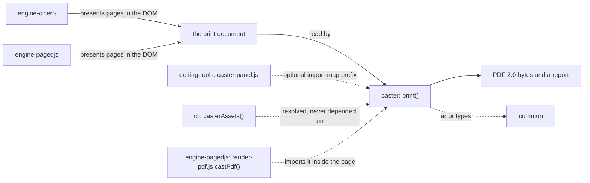
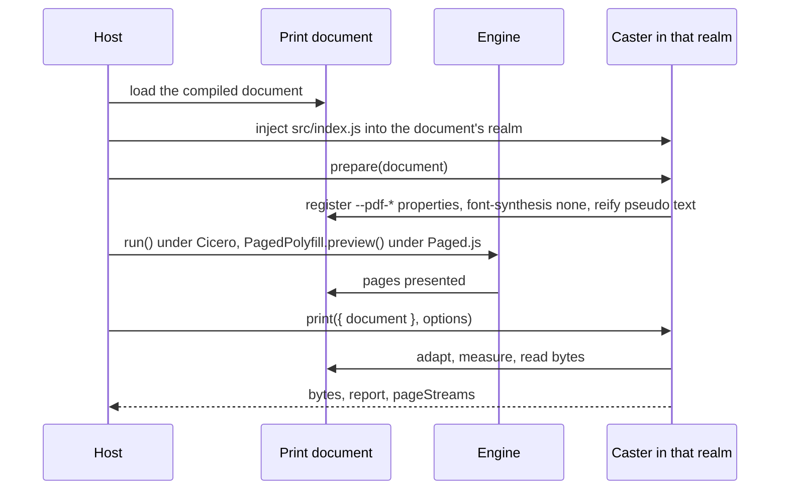
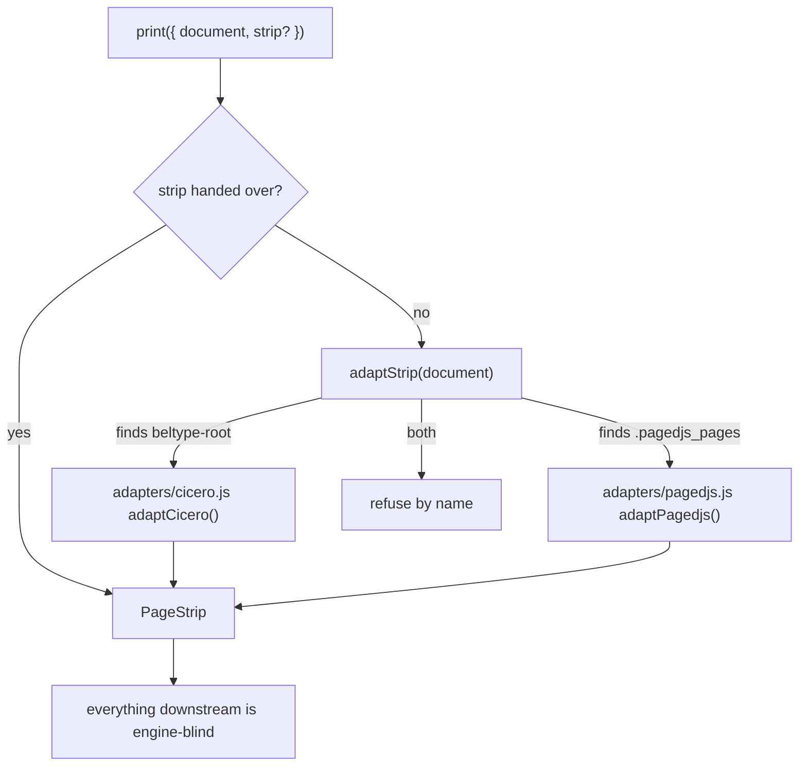
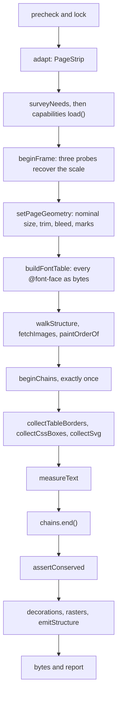
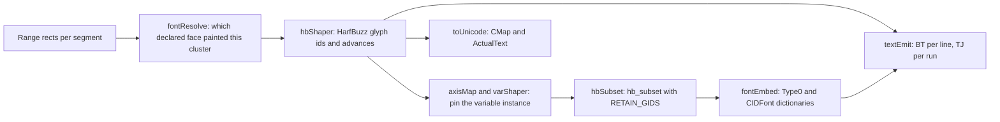
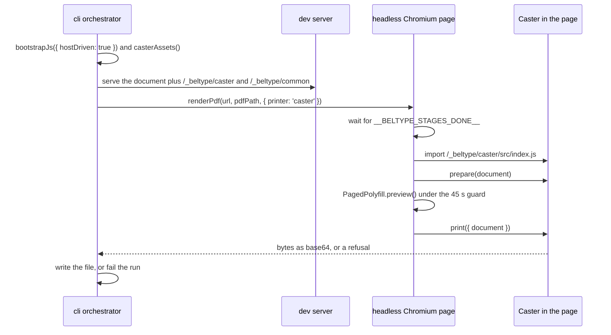

# The caster package

A browser can print a page to PDF. What comes out is a picture of the page with text on top: no structure a screen reader can walk, no colour a press can trust, fonts embedded however the browser saw fit. Caster is BelType's own printer. It runs inside the tab, reads the pages a paged-media engine has already laid out in the DOM, and writes a PDF 2.0 file. The file is also PDF/UA-2: real glyphs, real font programs, exact inks and a structure tree.

The package is private and unpublished. Nothing declares a dependency on it: the editing tools and the CLI each look for it and offer the printer only where it resolves. Its one runtime dependency is [the common package](#the-common-package), for the error types.

Its whole content is a port. Thirteen experiments in the sibling repository `browser-to-pdf-experiments` settled each capability separately and left a guide; this package composes them once. Every module under `src/` names its harness source, its experiments and its guide chapter in its first lines.

## Why a printer runs in the browser

Chromium's own print (`page.pdf()`, which `build --pdf` uses by default) is good enough for a proof and not for a deliverable. The gaps are structural, and none of them can be patched from outside the browser.

| What a deliverable needs | Chromium's print | Caster |
| :--- | :--- | :--- |
| PDF 2.0 with PDF/UA-2 tagging | no PDF/UA-2 claim, and no say over which element gets which tag | `%PDF-2.0`, a structure tree built from the DOM by a stated tag table, checked by veraPDF |
| Exact CMYK and spot colour | no channel for a CMYK value or a named ink | `device-cmyk()` and `spot()` hints written as `/DeviceCMYK` and `/Separation` |
| Real font programs | the browser's choice, system fallbacks included, with no report of which | every face read as bytes, instanced, subsetted with HarfBuzz, embedded |
| Images as authored | the browser's decision | a JPEG's or PNG's own bytes wherever PDF has a filter for them |
| Press geometry | one media box; marks are the engine's drawing | `/TrimBox`, `/BleedBox`, crop and registration marks, `/PageLabels` |

The reason it can live in the tab is that the browser already knows everything a printer needs. Layout is done; `Range.getClientRects()` says where every word landed; `getComputedStyle` says in which face and colour. Caster never decides where anything goes. It measures what the engine did and writes it down in PDF's terms.

## Where Caster sits among the packages



Solid arrows are data; dotted arrows are who reaches the module. Caster imports no engine. It knows two engines' DOM shapes through two small adapters, and everything after them is engine-blind. The hosts reach it without depending on it: `packages/editing-tools/src/import-map.js` lists `@egildo/beltype-caster` among its optional prefixes, and `packages/cli/src/client-assets.js`'s `casterAssets()` returns `null` where the package does not resolve.

## How Caster prints a PDF from presented pages

A print is three moves, and the host makes them in this order: `prepare()`, then the engine paginates, then `print()`. Preparation changes layout, so it has to happen before the first page is cut; otherwise the printer would measure pages that do not contain what it prepared.



The host drives both the engine and the printer. In every door the document is compiled with a bootstrap that paginates nothing on its own, which is what gives `prepare()` its moment.

```js
// the shape of a run, as each host writes it
const caster = await import('/_beltype/caster/src/index.js');
caster.prepare(document);
await window.PagedPolyfill.preview();          // or __beltypeCicero.run()
const { bytes, report, pageStreams } = await caster.print({ document }, { blackText: '100k' });
```

### What prepare() changes before the first cut

`src/adapters/prepare.js` is the one place the document is altered, and it is safe only because the document is the printer's own copy, discarded after the export. It does four things.

1. It registers the four page-level properties (`--pdf-bleed`, `--pdf-trim-inset`, `--pdf-marks`, `--pdf-page-label`) with `inherits: false`, so a declaration claims one element and never its subtree. The two lengths are typed `<length>`, so `6mm` arrives already computed to pixels.
2. It sets `font-synthesis: none` on the root. Chromium's fake bold changes no advance width, so a synthesised face would measure like the real one and print as neither.
3. It reifies pseudo-element text, described [below](#pseudo-elements-made-real-in-two-moments).
4. It turns GFM task checkboxes into text (`[ ]` and `[x]`), because PDF 2.0 has no tag for a checkbox that is not a form field.

> **Why not `@page { --pdf-bleed: 3mm }`.** Chromium's `@page` parser discards custom properties before the CSSOM sees them, registered or not. `packages/caster/DESIGN.md` records the measurement, *the `@page` parser discards a custom property* (S11), and the decision it forces, *the page-level properties are read from the document root* (S12). The page-level hints are therefore read from `:root`, and one declaration governs the whole document.

### The PageStrip contract and the two adapters

Caster asks one thing of whoever presented the pages: a **page strip**, a description of which element is the strip, which elements are pages, what flows on each, and which element continues which across a cut. It says nothing about how the cuts were decided. `src/adapters/strip.js` holds the contract as types only.

```js
// PageStrip, abridged from src/adapters/strip.js
{
  strip,            // the element holding every page; the structure walk runs over it
  probeRoot,        // where the frame's three probes are appended
  pageElements,     // the page boxes, in order
  pages: [{ element, index, flow, nominal: { widthPt, heightPt }, contentArea, trimBox, flowBox, continuations }],
  pageElementOf,    // (element) => the page it is on, or null
  twinOf,           // (element) => the element this one continues, or null
  transparent,      // (element) => true for the engine's own wrappers inside content
  inMargin,         // (element) => true for running heads and folios
  backgrounds, lang
}
```



The two engines leave very different DOMs, and the strip's shape absorbs the difference.

| Question | Cicero's answer | Paged.js's answer |
| :--- | :--- | :--- |
| Where are the pages laid out? | inside `<beltype-root>`'s open shadow root, stacked vertically | in the light DOM under `.pagedjs_pages` |
| What flows on page N? | the root slot's `assignedNodes()`, never the light DOM, which also holds unrendered originals | the page's own children, behind transparent chrome |
| How big is the page? | the inline width and height `chase.js` wrote | the `--pagedjs-width` and `--pagedjs-height` lengths the engine wrote |
| What is a block cut across pages? | clones: a constructed first fragment and continuations, the original on no page; the tail is laid out and clipped at `.flow` | the original on the first page and empty shells (`data-split-from`) the tail's nodes were moved into; nothing is clipped |
| Where are running heads and folios? | in page shadows, lifted into the light DOM by the adapter and stamped as artifacts | sixteen light-DOM margin cells, stamped as artifacts |
| How is a cut table joined? | every cell of a clone has a twin | the adapter stamps `data-pdf-table` so the fragments merge into one `Table` |

Each adapter also verifies what it pairs. Under Cicero, `verifyPartitions` checks that a divided block's first fragment and the fragment resuming it cover the block exactly, with no word on two pages and none on none. A wrong pairing would print one block's words under another block's structure element, so it is an export error naming the block.

A strip is a fact about a DOM, not about an engine. A host that knows its own pages may hand one over, and three sized `<div>`s in a `position: relative` container are a valid strip; `test/acceptance-strip.test.js` prints exactly that.

### The order inside print() and why it is load-bearing

`src/index.js`'s `print()` is the composition. It takes a lock first (`src/precheck.js`: Blink only, one export at a time, a warning when the device pixel ratio is not 1), because several ported modules keep module-scope state.



Four points in that order cannot move.

1. **The frame comes first**, because every later coordinate is page-local. An editor shows pages scaled, scrolled and offset; `src/coordinates/frame.js` puts three zero-size probes into the strip at `(0,0)`, `(K,0)` and `(0,K)` and reads the linear map back from where they were painted. A uniform scale and any translation are undone exactly. Rotation, skew, non-uniform scale, `zoom` and perspective are refused, naming the element.
2. **Page geometry comes next**, because the vector modules convert pixels to points through it.
3. **There is one `beginChains` for the whole export.** A transform does not affect layout, so `src/coordinates/ctm.js` sets every transformed ancestor to `transform: none` and lets everything be measured against the untransformed geometry. It carries the author's transforms into the PDF as matrices. The collectors and `measureText` all run inside that one neutralised window.
4. **Emission comes after `chains.end()`.** Anything that reads no layout (fetching image bytes, drawing a raster fallback into a canvas, writing the file) stays outside the window.

> **Why not a second `beginChains`.** A second call would capture the `transform: none` the first one wrote and find no chain at all. `print()` ends the chains in a `finally`, so a throw mid-measurement never leaves the author's transforms stripped.

## How Caster writes text

Text is where a browser-side printer earns its keep or fails quietly. The browser says where a word is and how wide; it never says which glyphs it drew. Caster has to reproduce the glyph sequence itself and prove it matches.



**Measuring.** `src/measure/textMeasure.js` records the engine's work segment by segment, a segment being a maximal run of non-whitespace inside one text node. That is narrower than a word on purpose, since `<strong>bold</strong>face` splits one. Every rectangle in the printer passes through this module's coordinate hub, so text, boxes and images share one frame.

**Resolving the face.** `src/host/fonts.js` reads every `@font-face` out of the CSSOM and fetches its bytes through the gateway. `src/fonts/fontResolve.js` then runs the CSS Fonts face-matching algorithm and the character-fallback walk over those descriptors, predicting which declared face painted each grapheme cluster. A cluster no declared family can paint is an export error naming the element, the family and the code points, because the printer embeds font programs and cannot embed one a tab cannot read. A family the document does not declare is passed over, and the report warns: if the machine has that family, the screen shows it and the PDF shows the declared one. BelType's addendum declares four open faces of its own for this reason, so a document with no `@font-face` still prints (`.claude/decisions/project/print-default-faces.md`).

**Shaping.** `src/fonts/hbShaper.js` shapes each run with harfbuzzjs, the same algorithm Blink runs, and gets the browser's widths and the browser's glyph sequence.

**Instancing and subsetting.** PDF accepts no variable font. `src/fonts/axisMap.js` derives the axis coordinates from the computed style; the face is pinned there with `hb_subset` before any metric is read, then subsetted to the used glyphs with `RETAIN_GIDS`, so the shaper's glyph ids stay valid as CIDs. `src/fonts/fontEmbed.js` writes the `Type0`/`CIDFontType2` (or `CIDFontType0` for CFF) dictionaries by hand, one program per face and coordinate pair. WOFF is unwrapped in `src/fonts/woff.js`; WOFF2 goes through a decoder that loads only when a face offers nothing else.

**Emitting.** `src/emit/textEmit.js` writes one `BT … ET` per line and one `TJ` array per run: glyph ids as hex strings, real space glyphs, and numeric adjustments that move the pen to where the browser put the next segment. Justification is adjustments only. `src/fonts/toUnicode.js` builds the `ToUnicode` CMap so the text extracts as the characters the author wrote. Colour emoji, which no PDF font can carry, are rasterised per cluster and wrapped in `/ActualText` (`src/measure/emoji.js`).

### The capability registry never falls back

The heavy libraries are never static imports. `src/capabilities.js` surveys the document first (`surveyNeeds` reads only the DOM and the CSSOM, never a fetched byte) and loads each bundle from `vendor/` only when something needs it. Every URL is relative to the module's own `import.meta.url`, so the registry works under any host that serves the package directory, with no import map.

| Capability | Bundle | Loaded when |
| :--- | :--- | :--- |
| `pdf` | `vendor/pdf-lib.js` | always (the object layer and the writer) |
| `fontkit` | `vendor/fontkit.js` | always (table parsing, metrics, glyph outlines) |
| `harfbuzz` | `vendor/harfbuzz.js` and `harfbuzz.wasm` | `shaper: 'harfbuzz'`, the default |
| `hbSubset` | `vendor/harfbuzz-subset.wasm` | `subset: 'hb'`, the default, under `writer: 'pdf-lib'` |
| `fastPng` | `vendor/fast-png.js` | an `` points at a `.png` and `pngDecoder` is `fast-png` |
| `woff2` | `vendor/wawoff2.js` | some `@font-face` has only WOFF2 sources |
| `profiles` | `profiles/srgb.icc`, `profiles/default_cmyk.icc` | the document has a colour story |
| `lcms` | `vendor/lcms.js` and `lcms.wasm` | `convertRgb: 'wasm'` or `convertImages: 'cmyk'` |
| `forme` | `vendor/forme.js` and `forme_bg.wasm` | `writer: 'forme'`; an absent module refuses by name, and the oracle is never taken in its place. In a page it writes in a dedicated worker (`src/emit/formeWorker.js`), and a page whose policy forbids the worker or WebAssembly refuses by name, never writing on the main thread |
| `localFonts` | none | never: a reserved door that refuses by name |

`capability(name)` returns the loaded bundle or throws a `CapabilityError` naming the capability and the flag that would have loaded it.

> **Why not fall back to fontkit's shaper.** Measured in the experiments: fontkit gets 97% and 82% of two test blocks' glyph sequences wrong at zero width error. A pipeline that fell back when HarfBuzz failed to load would pass every width assertion in the suite and print the wrong letters. So there is no fallback anywhere in the registry, and `shaper: 'fontkit'` refuses by name (*the capability registry never falls back*, `packages/caster/DESIGN.md` S6).

## How Caster carries images, vectors and colour

**Images as their own bytes.** The pixels on an element are what the compositor chose to show: colour-managed, 8-bit, possibly downsampled. The file is better, so `src/host/gateway.js` fetches the bytes behind `img.currentSrc` and sniffs the type from them. `src/images/imageEmbed.js` then asks one question per image: does PDF already have a filter that reads this file? A JPEG goes in verbatim under `/DCTDecode`, progressive and CMYK ones included. A non-interlaced PNG without alpha goes in as its own `IDAT` stream under `/FlateDecode` with the PNG predictor, 16-bit samples intact.

Only what PDF cannot read is decoded, and an opaque photograph stored as PNG may be re-encoded as JPEG once a measured 40 dB PSNR is cleared (`src/images/photoRule.js`). An image that prints far above its target resolution is reduced first (`downsampleImages`, `src/images/imagePass.js`), at the smallest resolution over every place the file is used, and under `convertImages: 'cmyk'` it is then converted to `DeviceCMYK` and travels as Flate samples. Stored size and EXIF orientation come from the file header, not from `naturalWidth`, which reports the size after the browser rotated the image.

**Vectors as paths.** Backgrounds, borders, rounded corners, shadows and gradients are collected from computed styles by `src/vectors/cssBoxes.js` and written as paths and shadings. Collapsed table borders are resolved on the grid lines by `src/vectors/tableBorders.js`. Inline SVG is walked by `src/vectors/svgGeometry.js` into PDF paths, its `<text>` measured character by character; an SVG served through an `` is parsed and seated as a drawing too, never rasterised (`src/images/svgInline.js`).

Underlines are rectangles placed from the face's own `post` table, cut around descenders the way Blink cuts them (`src/vectors/skipInk.js`). What PDF has no operator for, a blur or a conic gradient, becomes a raster at `rasterDpi` and is listed in the report as deferred. Painting follows CSS paint order (`src/walk/paintOrder.js`), while the structure tree stays in DOM order.

**Colour by hint.** A browser cannot represent a CMYK quadruple or a named ink, so the author states it in a custom property the browser ignores and the printer reads. The hints are registered `inherits: false`, so a hint on a section never claims its paragraphs.

```css
/* from fixtures/specimen/styles/specimen.css */
:root { --pdf-trim-inset: 6mm; --pdf-bleed: 3mm; --pdf-page-label: decimal start 1 "S–"; }
.exact-black  { --pdf-color: device-cmyk(0 0 0 1); }
.spot-heading { --pdf-color: spot('PANTONE 200 C', device-cmyk(0 1 0.65 0.15)); }
```

`src/colour/colorHints.js` parses `--pdf-color`, `--pdf-background` and `--pdf-overprint`; `src/colour/colorResources.js` writes `/DeviceCMYK` operands, `/Separation` spaces with their tint transforms, `/DefaultRGB` and the `/OutputIntents` entry. An absent hint means the RGB path. A hint that does not parse is an export error naming the element and the value. The 192 kB of ICC profiles load only when the document declares a hint, asks for marks, or sets `blackText`; the `colour` flag overrides that.

## The structure tree and the conservation of words

`src/walk/structure.js` turns the DOM into the tree the PDF carries. A table maps each HTML element the belt emits to a PDF 2.0 standard tag (`<blockquote>` to `Div`, `<pre>` to `P`, a `.footnote` span to `FENote`, a KaTeX span to `Formula` with its TeX as `/Alt`, and so on). Anything the table does not name is refused, custom elements included. Reading order is DOM order, always. Running heads, folios and decorative boxes are written as `/Artifact` and appear nowhere in the tree.

Two questions in the walk belong to the engine, and the adapter answers them through the strip. An element the adapter calls `transparent` introduces no node and its children are walked in its place. An element with a `twinOf` continues its twin's structure element instead of opening a second one, which is how a paragraph cut across two pages stays one `P`. `src/emit/structureEmit.js` then groups measured runs into marked-content sequences, one per owning element per page, and writes the tree, the parent tree, the outline from the headings, and the XMP.

That design has a price. Boxes and borders are read off whatever is rendered, while a glyph is emitted only for a block the walk registered: ink is a by-product of tagging. A text node the walk never classified is neither measured nor refused. It is absent, with its cell's border drawn neatly around the hole.

So after the measurement, `src/measure/conservation.js` takes a census that asks the DOM and never the tagger. It walks every text node under the strip, keeps the ones a reader can see on a page, and asks whether a block's walk claimed each one. If any did not, the print refuses, counting the words and naming the first few by element and page.

> **What the census found.** On the manual under Paged.js, a table continued across a cut kept every rule and lost every word on its later pages: 2 300 words over eight pages, zero errors, zero warnings. It also found the anonymous block (`<div>text</div>`, which no branch of the walk visited) and HTML labels inside an SVG `<foreignObject>`, which the vector walk paints as nothing. The last is why `packages/core/src/shell.js` asks Mermaid for SVG `<text>` labels (`htmlLabels: false`). Records in `packages/caster/DESIGN.md`: *the conservation of words* (S61), *a cut table is one table in several fragments* (S63) and *the anonymous block* (S64).

## Pseudo-elements made real in two moments

`::before`, `::after` and `::marker` paint text that no DOM node holds, so no marked-content sequence could claim it. `src/adapters/reify.js` replaces each with a real `<span>` carrying the same text and suppresses the pseudo-element with one injected rule. `getComputedStyle` reports `content` in specified form (`counter(h2) ". "`, never `3. `), so the module resolves CSS counters itself, in one document-order pass with proper scoping. Markers are keyed on computed `display: list-item` rather than on the `<li>` tag, which is what reaches a footnote body.

The function is idempotent and whole-document because it runs at two moments. `prepare()` calls it before pagination, over the author's content, so the pages the engine lays out contain the real elements. An adapter calls it again after pagination when the engine itself paints pseudo text. Under Paged.js every folio is `.pagedjs_margin-content::after { content: counter(page) }`. Footnote calls and numbers are pseudo content too, and none of it exists until the pages do.

## The printer runs in the realm it prints

Everything Caster touches is realm-sensitive: `getComputedStyle`, `Range`, `DOMRect`, `CSS.registerProperty`, `document.createElement` for a probe. A module imported into the application's realm would call the application's `window` for each of these while measuring another frame's document.

> **Why not import Caster into the app.** Measured: it fails at the first step, with the app window's `getComputedStyle` rejecting the frame's element as "not of type 'Element'". The experiments never met this because a fixture and its exporter shared one realm (*the printer runs in the realm it prints*, `packages/caster/DESIGN.md` S20).

So every host injects the module into the document being printed and talks to it there. The editing tools' `loadCasterInto` adds a second import map for the `@egildo/` prefixes (Chromium accepts one as long as nothing has resolved through the prefix yet) and loads the entry as a blob-URL module script. Because the registry resolves its bundles against `import.meta.url`, they are found from inside that document with no further help.

The print frame is a separate frame, because `prepare()` alters the document and the author's live preview must not change. It is `visibility: hidden` and never `display: none`: layout has to happen or nothing can be measured.

## The three doors into Caster

| Door | Host | Engine | How the module arrives |
| :--- | :--- | :--- | :--- |
| The print panel | `packages/editing-tools/assets/caster-panel.js`, `printOnce()` | Cicero, in a hidden print frame | optional import-map prefix, injected into the frame |
| The print panel under Paged.js | the same `printOnce()`, with `engine: 'pagedjs'` | Paged.js, via `paginatePaged()`, in a hidden print frame | the same |
| The command line | `packages/engine-pagedjs/src/render-pdf.js`, `castPdf()` | Paged.js, headless | served at `/_beltype/caster/` by `casterAssets()`, imported inside the page |

In the editing tools the panel prints from whichever engine is active. Under Cicero the frame is dressed first (the author's stylesheets adopted, as in the live pane), because Cicero reads `@page` geometry from the CSSOM. Under Paged.js the frame is dressed too, with the author's sheets adopted for the length of `prepare()` (the Polisher inserts them only inside `preview()`, after it). The preview is not prepared in either seat, under either engine: preparation must not change layout, so the pages the author looks at are the pages the file gets, and `test/preview-unprepared.test.js` checks it over every fixture. The panel's report lists pages, bytes, capabilities, fonts, images and warnings; an export error names an element, and where the belt stamped a source position it opens the author's line.

```bash
node bin/beltype.js edit packages/caster/fixtures/specimen/index.md    # then press print in the preview bar
node bin/beltype.js build ./test/specimen.md --pdf --printer caster    # the same printer, headless
```



`--printer` is a flag, not a config key, and takes `chromium` (the default) or `caster`. It requires `--pdf`. Under `--engine site` or `--engine cicero` it refuses by name, since neither presents pages to a headless run, and it refuses where the private package is absent from the install. A refusal inside the page is the run's failure, word for word.

> **Why not fall back to Chromium's print.** A file that silently came from the other printer is not the file that was asked for. Nobody could tell afterwards which one they hold.

## Caster's flags

`src/options.js` is the flag table; `resolveOptions` refuses an unknown flag or value rather than coercing it. Every default carries the measurement behind it as a comment there, and the panel shows the same help on hover.

| Flag | Values | Default | Why that default |
| :--- | :--- | :--- | :--- |
| `shaper` | `harfbuzz`, `fontkit` | `harfbuzz` | fontkit shapes wrong glyphs at correct widths; `fontkit` refuses by name |
| `subset` | `hb`, `pdf-lib` | `hb` | pdf-lib cannot show a shaper's glyph, instance a face or read WOFF2; `pdf-lib` refuses by name |
| `cffContainer` | `bare`, `opentype` | `bare` | both validate; the wrapper is 141 kB of dead weight on a CJK subset |
| `widthDecimals` | `3`, `0` | `3` | the specification's rule; integers cost up to half a thousandth of an em per glyph |
| `pngDecoder` | `fast-png`, `canvas` | `fast-png` | a canvas gets 64 094 of 65 280 low-alpha pixels wrong and has no 16-bit sample |
| `photoRule` | `true`, `false` | `true` | 3 826 435 B of PNG becomes 130 207 B of JPEG at 43.90 dB |
| `downsampleImages` | `true`, `false` | `true` | an image placed above `imageResolution × downsampleThreshold` is reduced to `imageResolution` before the list; no corpus image prints above 450 ppi, so no recorded byte moved |
| `imageResolution` | a positive number | `300` | the resolution an image is reduced to, in pixels per inch |
| `downsampleThreshold` | a number from 1 to 10 | `1.5` | the ratio above which it is reduced; outside 1 to 10 refused naming the flag |
| `downsampleType` | `bicubic`, `average`, `subsample` | `bicubic` | Catmull-Rom computed by Caster's own arithmetic (`src/images/resample.js`), whose bytes are the same in every engine |
| `convertImages` | `none`, `cmyk` | `none` | an image keeps its own colour and late binding stays the default. `cmyk` converts every RGB or grey image after its reduction, through the vendored lcms-wasm from its own profile (else sRGB) to the output intent's CMYK, relative colorimetric with black-point compensation, at eight or sixteen bits with its alpha beside it; the list carries `DeviceCMYK` samples (version 7). A CMYK JPEG is left alone and named in the report. Needs the colour objects: refused with `colour: 'off'`, and turns `colour: 'auto'` on. Images take lcms's default optimisation (text is converted exactly): about 12 times faster for a mean difference of 0.26 of an eight-bit level and at worst 7 on the corpus's photographs |
| `rasterDpi` | a positive number | `300` | every raster fallback and every emoji cluster is drawn at this |
| `paintOrder` | `css`, `dom` | `css` | CSS paint order is what Chromium paints; `dom` is wrong as soon as anything overlaps |
| `styledBorders` | `true`, `false` | `true` | a dotted or dashed border prints as written; `false` paints every border solid. Flipped on 2026-11-02, since no corpus document had a styled border |
| `blackText` | `none`, `100k` | `none` | turn on for press: otherwise `0 0 0 rg` lands ink on all four plates |
| `convertRgb` | `none`, `endpoint`, `wasm` | `none` | a compliant RIP lands within one 255th anyway. `wasm` converts the fill of every text run that has no declared ink (and, under `blackText: '100k'`, is not black) through the vendored lcms-wasm, with Caster's two profiles and relative colorimetric intent with black-point compensation, before the list is built; the list carries each as a CMYK ink, written `k`, and the report's `color.conversion` records the colours, the wasm's version and its load and transform times. Backgrounds, borders, drawings and images are not converted. `endpoint` refuses by name |
| `skipInk` | `true`, `false` | `true` | 34.2% of a body-size underline is removed by the descenders it would strike |
| `colour` | `auto`, `on`, `off` | `auto` | Caster's own: colour objects are written only when the document has a colour story |
| `unknownElements` | `refuse`, `infer` | `infer` | Caster's own: `infer` prints a custom element by its layout, lists each guess and drops the PDF/UA-2 claim; `refuse` refuses it by name |
| `standard` | `ua-2`, `none` | `ua-2` | Caster's own: `ua-2` claims PDF/UA-2 (and forme both Well-Tagged PDF declarations) and refuses by name a word gap in a face with no space glyph; `none` claims nothing and writes such a gap as positioning with no glyph |
| `writer` | `pdf-lib`, `forme` | `pdf-lib` | Caster's own: which writer turns the display list into the file, the TypeScript writer or forme, the Rust writer vendored as WebAssembly; both read the same list, and forme is held to the oracle's files by every reader of the gate, so the default stays the oracle's until the flip. In a page forme writes in a dedicated worker and holds no frame; the host must serve `src/emit/formeWorker.js` beside the other modules and allow a module worker from its origin (`worker-src`) and WebAssembly (`'wasm-unsafe-eval'`) |

## What Caster refuses and why refusing is the design

A print job cannot recover from a colour the author demanded and the exporter quietly dropped, or from a word that vanished. So each of these is an export error (`CasterError` and its subclasses in `src/errors.js`) naming the element, never a guess.

| Area | Refused by name |
| :--- | :--- |
| Fonts | a cluster that reaches a generic or system family; a character no declared face covers; a `CFF2` that survives pinning; an `@font-face` weight of `bolder` or `lighter` |
| Frame | a container that rotates, skews, scales non-uniformly, `zoom`s or applies perspective, checked in that order so the message names the true cause |
| Structure | an element the tag table does not name; a custom element under `unknownElements: 'refuse'` (the default, `'infer'`, prints it by its layout and the file claims no PDF/UA-2), and a `bt-` or `beltype-` element always; rendered text no block claimed |
| Pairing | a continuation that does not mirror its source (tag, child count, stamp); fragments that do not cover their block; a continued table with no earlier table |
| Alternatives | an `` with no `alt`, a `<canvas>` with no `aria-label`, an inline `<svg>` with no `<title>`, `aria-label` or `aria-hidden`; a `role="img"` with no `aria-label`, a `role="heading"` with no `aria-level`, a `role="listitem"` outside a list |
| Images | a 12-bit JPEG; an `` the engine broke across pages; an SVG-in-`` with an `object-fit` other than `fill` or `contain`, a non-default `object-position`, or bytes that are not SVG |
| Colour | a `--pdf-*` hint that does not parse; `--pdf-background-color`, `--pdf-border-*-color`, `--pdf-fill` and `--pdf-stroke`, which the painting does not read |
| CSS | a `list-style-type` outside the marker table; `text-transform: full-width` or `full-size-kana`; `content: url()` and quote functions in a pseudo-element; a `background-image` in `@page` that is not one `url()`, whose tile repeats inside the page, or that sets `background-origin`, `background-clip`, `background-attachment` or `background-blend-mode`; any under Paged.js |
| Flags | `shaper: 'fontkit'`, `subset: 'pdf-lib'`, `convertRgb: 'endpoint'`; any unknown flag or value |
| Run | a second `print()` while one runs; a browser that is not Blink; a document carrying both engines' roots |

A few things are deferrals rather than errors: `paint-order: stroke` over a gradient fill, `box-shadow: inset`, a `background-image` layer that is not a gradient. The box is still drawn, the reader still gets a page, and the report's deferred list says what was painted instead.

## The display list

`print()` does not write the file from the page. It builds a display list first: the document as plain data, in the order the writer paints it, every length in points, every font program, image and ICC profile a blob under its SHA-256, the structure tree already resolved, each font instance's widths, the creation date and the colour story. The writer, `emitStructure(list)`, reads that list and nothing else, and returns the file and the records of what it chose (the MCIDs, the pen adjustments, each font's subset, each image's XObject). The same list prints the same bytes, in the page and in node, on any machine (*the same list prints the same bytes*, `DESIGN.md` S102). That is what lets a second writer, in another language, be written against the list alone.

The schema is one file, `src/displayList.ts`, and what a writer returns is another, `src/displayList/contract.ts`. `validateList(list)` refuses a list no writer could write, with a sentence for each refusal, and `recordsOf(list, records)` makes everything the report derives from a writer's records.

| Face | What it is for |
| :--- | :--- |
| `@beltype/caster` | `print()`, `prepare()`, `reify()`, the flag table: printing a document in its tab |
| `@beltype/caster/display-list` | the display list's types, `validateList` and `recordsOf`: reading, checking or writing a list outside `print()` |
| `@beltype/caster/internal/*` | any module by path, unstable; the editing tools read the types of `options`, `report` and `adapters/strip` through it |

The identity script holds the writer to its own earlier output. It has three verbs:

```bash
npm run identity -- record [dir] [--list-out [dir]]   # print the corpus through the CLI's door; with --list-out also save each list, its blobs and its report
npm run identity -- check [dir]                       # print it again, compare the bytes and the report snapshots with what was recorded
npm run identity -- replay [dir]                      # node, no browser: validate each saved list, write it, compare the bytes with the recorded file
```

Two writers can agree and both be wrong, so one more verb holds the files to the browser:

```bash
npm run identity -- browser <dir> [--out <dir>]       # each drawing a corpus page names by data-drawing, Chromium's page against the oracle's file and forme's in <dir> under mupdf and yapr
```

`<dir>` is what `replay --writer forme --out <dir>` wrote. The method and the line are `againstBrowser`'s, in `scripts/compare.ts`: each drawing's region is registered on the browser's by up to two CSS px, then a pixel's difference is how far it lies outside its 3 × 3 neighbourhood in the other render, so antialiasing is forgiven and a wrong colour or shape is not; a drawing passes within one CSS px of registration, no pixel past 64 of 255 and no more than 0.5 % of its region past 8. `fixtures/roads/vector-roads.html` names its drawings.

`dir` defaults to `fixtures/lists/`. `record` and `check` need the CLI's checkout (`BELTYPE_CLI`, the sibling `../cli` by default) and Chromium; `replay` needs neither. None of them runs in `npm test`, which replays the committed lists on its own (`test/displayList.test.ts`, `test/determinism.test.ts`).

`fixtures/lists/` is the corpus, committed: for each of eight documents the file the page printed (`<name>.pdf`), its display list without blobs (`<name>.json`) and its report with the timings removed (`<name>.report.json`); `blobs/` holds each blob once under its SHA-256; `corpus.json` names every file's hash and the blobs each list uses. The documents are `@beltype/specimens`' paper, the cast fixture and its divided row, and five pages under `fixtures/roads/` that take the roads the paper does not (rotated text, gradients and soft masks, spot inks, print marks, a raster fallback, a facsimile, a WebP, an arithmetic JPEG, an opaque photo).

## Caster's files

| Path | What it owns |
| :--- | :--- |
| `src/index.js` | `print()`, the whole composition; `adaptStrip`, `surveyNeeds`; re-exports `prepare` and `reify` |
| `src/options.js`, `src/capabilities.js`, `src/precheck.js` | the flag table; the registry that never falls back; the lock, the Blink check, the DPR warning |
| `src/report.js`, `src/errors.js` | the record every checker reads; the `CasterError` family |
| `src/displayList.js`, `src/displayList/` | the list's schema; `build.js` (the builder), `structure.js` (the resolved tree), `contract.js` (what a writer returns), `records.js` (`recordsOf`), `validate.js` (`validateList`) |
| `src/adapters/` | `strip.js` (the contract, types only), `cicero.js` and `pagedjs.js` (the two modules that know an engine's DOM), `prepare.js`, `reify.js` |
| `src/coordinates/` | `frame.js` (probes and refusals), `ctm.js` (transform chains), `pageGeometry.js`, `printMarks.js`, `units.js` |
| `src/host/` | `gateway.js` (who may read which bytes), `fonts.js` (the `@font-face` descriptor table) |
| `src/walk/` | `structure.js` (the tag table and the tree), `paintOrder.js`, `tableModel.js`, `tableHeaders.js` |
| `src/measure/` | `textMeasure.js` (the measurement and the one coordinate hub), `conservation.js`, `emoji.js` |
| `src/fonts/` | resolve, shape, instance, subset, embed, `ToUnicode`, WOFF |
| `src/images/` | passthrough, PNG and JPEG parsing, the photo rule, placement, SVG inlining, raster fallbacks |
| `src/colour/` | hint grammar, PDF colour resources, RGB to CMYK (held, not composed) |
| `src/vectors/` | CSS boxes, SVG geometry and markers, border styles, shadings, transparency, decorations, skip-ink, table borders |
| `src/emit/` | `structureEmit.js` (the file), `textEmit.js`, `document.js`, `pdf20-writer.js`, `outline.js`, `pageLabels.js` |
| `vendor/` | committed browser bundles and wasm, generated by `scripts/bundle-vendor.js`; `vendor/README.md` lists each |
| `profiles/` | `srgb.icc`, `default_cmyk.icc`, committed; `scripts/profiles.sh` verifies their checksums |
| `fixtures/` | `lists/` (the committed display lists, their blobs and the files printed from them), `roads/` (the corpus's small documents), `specimen/` (the venue the printer is proved on), `default-faces/`, `margins/`, `pairing/` |

Everything under `src/` is plain ESM with JSDoc types. Every module's header opens by naming its harness source and experiments (`Ported from <harness file> (E#)`) and the guide section it follows, or says `Caster's own; no harness source` and why, then what the port changed; a reader can go from any file to the experiment that settled it. The whole package is checked (`checkJs: true` in `jsconfig.json`), so a file needs no `// @ts-check` line, and `test/check.test.js` runs the check inside `npm test` and skips where `typescript` is not installed. The convention is BelType's, generalised from this package's own mode (*`npm run check` types Caster's own files*, `packages/caster/DESIGN.md` S5), and its reasons are [`.claude/decisions/project/types-live-beside-the-code.md`](../../.claude/decisions/project/types-live-beside-the-code.md). Caster checks against its siblings' real types, with no hand-written sibling stubs and no `paths` lines for them: every sibling is typed and checked, which answers that proposition's reason (untyped siblings whose errors became Caster's) at its source. The stubs had drifted as a second authority does: `isWithin`'s arguments were declared reversed, and the browser was typed `any`, which is how a puppeteer-only verb once type-checked for two days. `capability(name)` is typed by `CapabilityMap` and answers `CapabilityMap[name]` with no `| undefined`, which is "never a fallback" in a form the checker holds. pdf-lib and fast-png are typed from the declarations their packages ship; fontkit, harfbuzzjs, lcms-wasm and wawoff2 stay `any` (`types/vendor.d.ts`), because a hand-written surface would be a second version to keep in step. A cast to `any` carries a note saying why, and pdf-lib's protected internals are the expected case. `colour/hintPaints.js` and `fonts/fontkitShaper.js` are ported and tested but not reached by `print()`; the flags that would reach them refuse. `colour/rgbToCmyk.js` is reached under `convertRgb: 'wasm'` only; its endpoint half is not.

## Running and testing Caster

```bash
cd packages/caster
npm test                # node --test test/*.test.js
npm run check           # tsc -p jsconfig.json, over this package's own files (also run by npm test: test/check.test.js)
npm run compliance -- fixtures/lists   # qpdf, veraPDF and PdfCraft over every PDF in a directory
npm run census          # the intervals census over every document (about a minute); exits non-zero if it does not complete
npm run bundle-vendor   # regenerate vendor/ after a dependency bump
npm run profiles        # verify the two committed ICC profiles against their recorded checksums
```

Most suites under `test/` are pure and run anywhere. The ones that need a real tab (the four acceptances, margins, pairing, reify and the vendor-bundle proof) launch Chromium through [the browser-chromium package](#the-browser-chromium-package) and skip with the launcher's own message where it is absent. The acceptances do not compare the report with itself: `test/read-back.js` opens the printed file with mupdf and asks it where the words are. `test/read-back-yapr.js` asks yapr the same question, a second reader built on hayro and vendored under `test/vendor/yapr/`, so that one reader's habit cannot pass for a fact about the file. `test/pixels.test.js` asks yapr for pixels too: it photographs every page the browser presented, renders the printed file's pages on the same grid, and scores every glyph the file draws against the glyph the browser painted there, by template matching (*the pixel reader*, DESIGN.md S95). It reports and does not gate yet; `CASTER_PIXELS_OUT=<dir>` leaves both images of every page. `test/read-back-a11y.js` runs PdfCraft's accessibility checker over every print, Acrobat's full check compiled to WebAssembly and vendored under `test/vendor/pdfcraft-a11y/`. The acceptances fail on any rule but the table summary, which PDF/UA-2 does not require, and the Cicero acceptance first strikes one Figure's alternate text and asserts the checker sees it.

| Acceptance | The road it drives |
| :--- | :--- |
| `test/acceptance.test.js` | the editing tools' panel over Cicero |
| `test/acceptance-pagedjs.test.js` | the editing tools under Paged.js; asserts the file has the preview's page count |
| `test/acceptance-cli.test.js` | the real `Orchestrator` with `--pdf --printer caster` |
| `test/acceptance-strip.test.js` | `print({ document, strip })` over a host's own strip, no engine |

`npm run census` is a deliberate act too, kept out of `npm test` for its time. It opens the specimen, the manual and the Paged.js road in Chromium and takes about a minute (it was fifty-three seconds of every test run, a third of the package's wall clock). It judges nothing it measures: stage 0's predictions are reported to a person, and the command fails only if the census itself does not complete.

`npm run compliance -- <dir>` is kept out of `npm test` deliberately. veraPDF is a large Java application and qpdf a separate binary, both found on the path, and a suite that skipped itself on most machines would be a green nobody can explain. The script prints nothing: it reads every PDF in the directory, runs `qpdf --check` (well-formed, and the header says 2.0), veraPDF with `--flavour ua2` (the PDF/UA-2 profile itself), `wt1a` and `wt1r` (Well-Tagged PDF), and PdfCraft's checker, and says plainly what it could not run. A file that fails qpdf or any `ua2` rule fails the run, in any directory; over another writer's files a verdict that differs from the oracle's of the same name in `fixtures/lists/` fails too. On the corpus, `wt1a`, `wt1r` and PdfCraft are reported and do not fail: their only findings there are the oracle's two missing Well-Tagged declarations and the table summary. The last recorded pass is 2026-11-07, over the 18 files of `fixtures/lists/`: qpdf 12.4.2 clean on 18, veraPDF 1.30.0 `ua2` with zero failed rules on 18 (40 944 checks passed). The one veraPDF ua2 test inside `npm test` is `test/pdfua.test.ts`, over the paper and the canvas figure, which skips where `verapdf` is not on the path.

Two preview seats in `.claude/launch.json` open the specimen: `beltype-caster` under Cicero and `beltype-caster-pagedjs` under Paged.js.

## Reading further on Caster

- `packages/caster/DESIGN.md` is the numbered record of every decision and measurement, including the ones that came back other than planned. Read it before changing anything here.
- `packages/caster/PLAN.md` is the brief the first coding round executed against; its section and rule numbers are what module headers cite.
- `packages/caster/NOTE-the-engine-names-the-source.md` is a note from Cicero's side for Caster's next round: the engine now answers `sourceOf(element)`, and the adapter's own pairing has not yet been moved onto it.
- `packages/caster/vendor/README.md` and `packages/caster/profiles/README.md` say what each committed binary is and where it came from.
- `.claude/decisions/project/print-default-faces.md` and `.claude/decisions/project/paged-js-returns-in-its-own-window.md` are the two repository decisions Caster leans on.
- The host sides are told in [the editing-tools package](#the-editing-tools-package), [the engine-pagedjs package](#the-engine-pagedjs-package) and [the cli package](#the-cli-package); the engine whose pages it most often reads is [the engine-cicero package](#the-engine-cicero-package).
