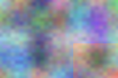
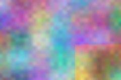
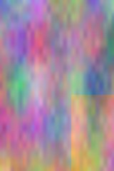
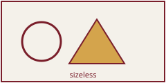

<p class="running-mark">Printed <em>by</em> Caster</p>

# The Caster specimen

This document exists to be printed. Every construct below is here because the printer has to answer something about it, and nothing is here that BelType's belt cannot produce — the specimen is a *document*, not a fixture, and it compiles through the ordinary pipeline with no plugin of its own.

The body face is Crimson Text and the code face is JetBrains Mono, both declared as `@font-face` in the venue's own sheet, because the printer embeds font programs and cannot embed a system font a tab is not allowed to read.

## What the walk has to tag

A paragraph with *emphasis*, **strong emphasis**, an [external link](https://example.org/), a [fragment link](#the-table), an `abbr` for HTML, a subscript H~2~O and a superscript E=mc^2^, some `inline code`, a ~~struck~~ phrase, and a span in another language: <span lang="it">la composizione della pagina</span>.

A line drawn under <u>typography</u> is cut where the descenders cross it, which is what Blink does and what the printer has the outlines to do: the `g`, the `y` and the `p` each take a bite out of the rule, and the strike above is painted straight through.

<p class="sidebar" lang="it">Una nota a margine, che galleggia a destra: il browser la dipinge al quarto passo dell'Appendice E, prima del testo in linea che la segue, e l'albero della struttura deve continuare a leggerla dopo il paragrafo che la precede.</p>

A footnote's reference sits in the flow and its text is relocated to the foot of the page.[^one]

[^one]: The relocation is the belt's `inlineFootnotes`; the `float: footnote` that puts it at the foot is the author's own rule, because `.footnote` is styled by no stratum.

### Lists, and the markers the printer has to materialise

- An unordered item, whose marker is a disc.
- A second item.
- A third, longer item so the list is not all one line and the marker of a wrapped item is measured where the browser put it.

1. An ordered item.
2. A second.
3. A third.

A nested list, and a loose item whose body is two paragraphs — both of them a block inside a block, which the walk refused outright until S28:

- alfa
  1. bravo
- charlie

- The loose item's first paragraph, which is a `<p>` inside an `<li>`.

  The loose item's second paragraph, so the item body holds two blocks and neither of them is the item.

Numbered from four:

<ol start="4">
<li>The fourth item.</li>
<li>The fifth.</li>
</ol>

A definition list, which becomes an `L` whose `Lbl` is the term:

<dl>
<dt>Recto</dt>
<dd>The right-hand page of a spread, and the odd-numbered one.</dd>
<dt>Verso</dt>
<dd>Its other half.</dd>
</dl>

### The table {#the-table}

A table with header cells in the head row and in the first column, which is the shape `docs/guide/tables.md` builds the whole header algorithm for.

| Stage | What it produces | Where the rule is |
| :--- | :--- | :--- |
| walk | a structure tree with an owner for every content item | `structure-tree.md` |
| measure | a rectangle and a baseline per word | `text-emission.md` |
| shape | glyph ids and advances that reproduce the browser | `shaping.md` |
| embed | one program per face and coordinates | `font-embedding.md` |

### A figure, a raster, and a decorative image



<figure>

<figcaption>A JPEG needs no decoder at all: PDF has a filter for it.</figcaption>
</figure>




An `alt=""` is a claim rather than an omission, and the only honest way to paint it is as an artifact outside the tree.



That last file is an SVG with a `viewBox` and no intrinsic size, which is a bitmap no browser will decode. It is not decoded: an SVG that arrives through an `` is seated where the `` stood and painted by the same vector road as an inline drawing, so its `<text>` reaches the text layer as glyphs and its shapes reach the page as paths.

#### A heading at a variable weight {.variable-heading}

A `wght` axis is frozen at the coordinate the browser painted, because a PDF carries no variable font at all: this heading asks for 700 and <span class="variable-text">this span asks for 400</span>, and the same programme is embedded twice, once per instance, each with its own subset tag.

### A quotation, a rule, and a code block

> Reading order is DOM order, always. Sorting the tree by where the ink landed reads correctly on every easy fixture and silently scrambles every hard one.

---

```
beltype edit packages/caster/fixtures/specimen/index.md
if width -> height && a != b && c <= d then scale => fit
```

The code face builds those arrows by substituting every character but the last for one deliberately empty glyph, so the monospace advance is kept and the last character draws the whole ligature backwards over them. An empty glyph is the face's own design and not a subset that dropped something.

### An inline drawing

<svg width="120" height="60" viewBox="0 0 120 60" xmlns="http://www.w3.org/2000/svg"><title>Two rectangles and a line, drawn as vector paths rather than rasterised.</title><defs><linearGradient id="glyphFill" x1="0" y1="0" x2="1" y2="0"><stop offset="0" stop-color="#7a1f2b"/><stop offset="1" stop-color="#d4a44c"/></linearGradient></defs><rect x="4" y="8" width="48" height="44" fill="none" stroke="#333" stroke-width="2"/><rect x="68" y="8" width="48" height="44" fill="#ddd" stroke="none"/><line x1="52" y1="30" x2="68" y2="30" stroke="#333" stroke-width="2"/><text x="8" y="33" font-size="9" fill="#555">stroked</text><text x="72" y="33" font-size="9" fill="url(#glyphFill)">filled</text></svg>

<svg width="120" height="30" viewBox="0 0 120 30" xmlns="http://www.w3.org/2000/svg"><desc>A drawing described by a desc alone: one bar, the way a Mermaid diagram arrives when its author wrote no title (M6).</desc><rect x="10" y="10" width="100" height="10" fill="#5b6b7a"/></svg>

A `<text>` is positioned character by character rather than laid out in lines, and it is measured through the page frame the engine put the drawing on: a label on page two belongs to page two. The second label asks for a gradient fill, which is painted as the current colour and deferred by name.

<p class="gradient-border">A gradient <code>border-image</code>, which is a picture where the printer's border model has one flat colour per side. It is painted as the flat <code>border-color</code> and deferred by name, because a deferral nobody sees is a silent guess.</p>

### Mathematics, and the copy nobody paints

KaTeX renders a formula twice: once as MathML for a reader that speaks it, once as positioned spans for the eye. The accessibility half is hidden at a pixel and its TeX source is hidden outright, so neither is measured — the whole `.katex-mathml` subtree is skipped and the `<annotation>` with it. Inline, $a + b = c$; and set on its own line:

$$|\,\text{rect} - \sum \text{advances}\,| = 0.333\text{pt}$$

### Colour the author demanded

<p class="exact-black">This paragraph names exact process black, so it is written as <code>0 0 0 1 k</code> and lands ink on one plate rather than on four.</p>

#### A heading in a spot ink {.spot-heading}

A `spot()` names an ink by its own name, and a `/Separation` colour space is what carries it into the file.

## A block that straddles a cut {.straddler}

@include{src="./chapters/long.md"}
